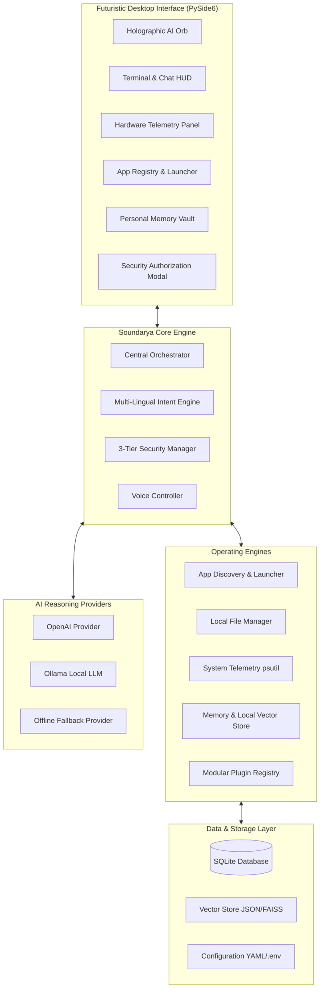

# SOUNDARYA — Personal AI Operating Assistant ◈

[](https://www.python.org/)
[](https://www.qt.io/)
[](#security-and-privacy)
[](#)

> **"JARVIS-inspired, local-first, multi-lingual personal AI operating assistant designed to interact naturally through voice and chat, execute authorized system operations, manage personal files, maintain private memory, and control desktop applications."**

---

## 1. System Architecture



---

## 2. Technology Stack

| Layer | Technologies Selected | Justification |
| :--- | :--- | :--- |
| **Desktop Application** | **PySide6 (Qt for Python)**, `QPainter`, QSS | High-performance 60 FPS procedural rendering for holographic AI core, glassmorphism dark theme, native cross-platform support. |
| **Operating System Bridge** | `subprocess`, macOS `open -a`/`osascript`, Windows `os.startfile`/ShellExecute, Linux `xdg-open` | Native zero-latency process execution, Start Menu / Application bundle scanning without hallucinating paths. |
| **System Telemetry** | `psutil` + Standard library OS metrics | Real-time hardware telemetry (CPU %, RAM %, Disk free space, Battery %, Uptime) without simulation. |
| **AI Reasoning Engine** | OpenAI API (GPT-4o), Ollama (Local LLM), RuleFallback | Modular provider interface supporting zero-network local execution as well as state-of-the-art cloud models. |
| **Intent Recognition** | Multi-lingual regex & phonetic entity extraction | Native support for **Hindi, Hinglish, and English** operational commands ("Chrome kholo", "system status batao"). |
| **Voice Processing** | `speech_recognition` (STT), macOS `say` / Windows SAPI / Piper TTS | Low-latency audio capture with Push-to-Talk and user-consented continuous listening modes. |
| **Personal Database** | SQLite, SQLAlchemy ORM | Local-first, private encrypted storage for user profiles, memories, app history, conversation transcripts, and tasks. |
| **Knowledge RAG** | `LocalVectorStore` (TF-IDF cosine similarity) | Zero-dependency local vector store for document indexing (PDF, TXT, MD) and semantic context retrieval. |

---

## 3. Directory Structure

```
/Applications/SAUNDARYA/
├── main.py                     # Primary desktop entry point (GUI & CLI fallback)
├── requirements.txt            # System dependencies
├── .env.example                # Environment variables template
├── .env                        # Active runtime configuration
├── README.md                   # Complete architectural documentation
├── config/
│   ├── settings.yaml           # Assistant, UI, Voice, and System settings
│   └── permissions.yaml        # 3-tier security matrix & rules
├── app/
│   ├── core/
│   │   ├── config.py           # Configuration loader
│   │   ├── engine.py           # Soundarya central coordinator
│   │   ├── security.py         # 3-tier permission validator
│   │   └── state.py            # Assistant state machine & data models
│   ├── ui/
│   │   ├── main_window.py      # Flagship PySide6 desktop HUD
│   │   ├── theme.py            # Futuristic QSS dark stylesheet
│   │   └── components/
│   │       ├── ai_orb.py       # Procedural animated AI Core widget
│   │       ├── chat_panel.py   # Conversational terminal & quick actions
│   │       ├── system_monitor_panel.py # Real-time CPU/RAM/Battery gauges
│   │       ├── app_launcher_panel.py   # Application registry & search
│   │       ├── memory_panel.py         # Personal memory vault UI
│   │       └── confirm_dialog.py       # Level 2 authorization modal
│   ├── ai/
│   │   ├── provider_base.py    # Abstract LLM provider interface
│   │   ├── openai_provider.py  # OpenAI GPT-4o integration
│   │   ├── ollama_provider.py  # Ollama local LLM integration
│   │   ├── rule_fallback_provider.py # Offline conversational fallback
│   │   └── intent_engine.py    # English/Hindi/Hinglish intent classifier
│   ├── voice/
│   │   ├── stt.py              # Speech-to-Text transcriber
│   │   ├── tts.py              # Text-to-Speech audio synthesizer
│   │   ├── wake_word.py        # Wake word detector
│   │   └── voice_controller.py # Push-to-talk & continuous mode
│   ├── database/
│   │   ├── db_engine.py        # SQLite connection manager
│   │   ├── models.py           # Schema definitions
│   │   └── repositories.py     # Data access repositories (Profile, Memory, Apps, Tasks)
│   ├── memory/
│   │   ├── memory_manager.py   # Personal facts and privacy lifecycle
│   │   └── vector_store.py     # Semantic RAG document engine
│   ├── system/
│   │   ├── os_bridge.py        # Cross-platform OS bridge
│   │   ├── app_launcher.py     # Installed app discovery and launch
│   │   ├── file_manager.py     # Local file browsing & search
│   │   └── monitor.py          # Real-time hardware telemetry
│   └── plugins/
│       ├── base_plugin.py      # Abstract plugin specification
│       ├── app_launcher_plugin.py
│       ├── file_manager_plugin.py
│       ├── system_monitor_plugin.py
│       ├── notes_plugin.py
│       ├── tasks_plugin.py
│       └── rag_knowledge_plugin.py
├── data/
│   ├── soundarya.db            # SQLite personal database
│   ├── vector_store/           # Semantic index files
│   └── documents/              # Personal knowledge base files
├── tests/                      # Automated unit and integration test suite
└── scripts/
    ├── setup_env.sh            # Automated virtual environment installer
    └── run.sh                  # Application launcher
```

---

## 4. Multi-Lingual Command Reference

SOUNDARYA natively understands commands in **Hindi, Hinglish, and English**:

| User Command (Voice or Text) | Intent Category | Action Performed |
| :--- | :--- | :--- |
| `"Soundarya, Chrome kholo"` | `app:open` | Locates Google Chrome in registry and launches process. |
| `"Soundarya, VS Code open karo"` | `app:open` | Launches Visual Studio Code. |
| `"Soundarya, meri Downloads folder open karo"` | `folder:open` | Opens `~/Downloads` in native file browser. |
| `"Soundarya, system status batao"` | `system:status` | Reads live CPU %, RAM %, Battery %, and Disk free space. |
| `"Soundarya, remember that passport expires next year"` | `memory:add` | Stores note into private personal SQLite database. |
| `"Soundarya, meri personal notes mein AI project search karo"` | `memory:search` | Searches notes vault and returns matching context. |
| `"Soundarya, aaj ka schedule batao"` | `task:list` | Lists pending tasks and reminders for today. |
| `"Soundarya, search files named quarterly_report"` | `file:search` | Traverses local documents for filename matches. |

---

## 5. Security & Permission Clearance Tiers

All actions executed by SOUNDARYA pass through the security matrix in `config/permissions.yaml`:

```
┌────────────────────────────────────────────────────────┐
│  LEVEL 1: SAFE (Non-destructive / Read-Only)           │
│  • App Launch • File Search • System Status • Read Mem │
│  → Executed immediately without prompt                │
└────────────────────────────────────────────────────────┘
                           │
┌────────────────────────────────────────────────────────┐
│  LEVEL 2: CONFIRMATION REQUIRED (State-Changing)       │
│  • File Delete • Kill Process • Clear DB • Screenshot  │
│  → Triggers interactive UI Authorization Dialog        │
└────────────────────────────────────────────────────────┘
                           │
┌────────────────────────────────────────────────────────┐
│  LEVEL 3: RESTRICTED (Prohibited Operations)           │
│  • Credential Exfiltration • Format Drive • Root Inject│
│  → Strictly BLOCKED by security kernel                 │
└────────────────────────────────────────────────────────┘
```

---

## 6. Installation & Quick Start

### Prerequisites
- Python 3.9+ (Python 3.10+ recommended)
- macOS, Windows 10/11, or Linux

### Quick Setup

```bash
# 1. Clone or navigate to the repository
cd /Applications/SAUNDARYA

# 2. Run automated setup script
./scripts/setup_env.sh

# 3. Launch Desktop GUI
./scripts/run.sh

# Or run in interactive terminal mode:
python3 main.py --cli
```

---

## 7. Running the Test Suite

SOUNDARYA includes comprehensive unit and integration tests covering all subsystems:

```bash
python3 -m unittest discover -s tests -p "test_*.py" -v
```

All 24 test cases verify:
- Database CRUD & Repositories (Profile, Memories, App Registry, Tasks)
- Intent classification across English, Hindi, and Hinglish queries
- Security enforcement (Level 1 pass, Level 2 prompt/reject, Level 3 block)
- Real hardware telemetry readings
- Local semantic vector store ingestion and retrieval
- End-to-end command routing through plugins
